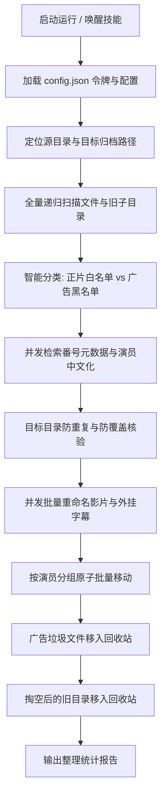

# PikPak 云端影视批量整理与广告清理 (PikPak Video Organizer)

本技能为通用 AI Agent 与用户提供对 PikPak 私人云盘的高性能批量整理能力：通过 REST API 直连实现秒级多并发扫描、番号识别、元数据自动刮削、外挂字幕同步、演员目录原子级批量归档，以及博彩广告垃圾文件的彻底过滤与回收站清理。

---

## 核心特性

1. **REST API 极速并发**：规避 WebDAV 服务端写限制与慢速问题，基于官方 API 采用 15 并发重命名与原子级批量移动（100+ 视频整理仅需数秒）。
2. **多级目录智能寻址**：支持在根目录或深层路径自由选择源待整理目录（如 `My Pack`）与目标收纳总目录（如 `女优` 或 `影视/日韩`）。
3. **元数据自动中文化**：集成在线元数据查询与内置常用女优映射表，支持番号识别、女优名繁简规范化（如 `八掛うみ -> 八挂海`）、原盘版本后缀保留（如 `-UC`, `-U`, `.restored`）。
4. **双层垃圾与广告过滤**：
   - **严格白名单**：正片限制为视频格式（`.mp4, .mkv, .avi, .wmv, .mov, .ts, .flv`）、体积 $\ge 50\text{ MB}$、具备合规番号；字幕限制为主流外挂格式（`.srt, .vtt, .ass, .ssa`）。
   - **广告黑名单特征拦截**：针对伪装带有番号但包含博彩/推广特征词（如“澳门”、“新葡京”、“威尼斯人”、“台妹子”、“发廊”、“福利群”、“菠菜”、“荷官”等）的超大广告短片，一票否决移入垃圾。
   - 所有博彩 APK、推广图片、HTML/CHM 导航、短视频切片 100% 自动归入垃圾处理池。
5. **智能防重复与防覆盖**：扫描目标演员目录已有影片，完全同体积文件自动跳过，不同版本文件自动追加 `_1.mp4` 保全，杜绝数据覆盖。
6. **无损安全回收站**：垃圾文件与已掏空的旧子目录统一调用 `delete_to_trash` 移入网盘回收站，随时可在客户端一键还原。
7. **一键双击直接执行**：提供 Windows 批处理启动器，已移除扫描后的中间确认步骤，极速直达完成。

---

## 目录结构

```text
skills/pikpak-video-organizer/
├── SKILL.md                          # 技能定义与 Agent 指令手册（本文件）
├── README.md                         # 详细配置、部署与用户使用指南
├── scripts/
│   ├── pikpak_organizer_pro.py       # 核心整理引擎 (Python 3.10+)
│   ├── PikPak一键极速整理.bat         # Windows 双击快速启动脚本
│   └── config.example.json           # 配置文件模板（隐私安全脱敏）
└── tests/
    └── test_code_parser.py           # 番号解析、FC2 适配与广告过滤单元测试
```

---

## 工作流与执行步骤



---

## 依赖与环境要求

- Python 3.10+
- 依赖库：`pikpakapi`、`httpx`、`beautifulsoup4`
- 安装命令：
  ```bash
  pip install pikpakapi httpx beautifulsoup4
  ```
