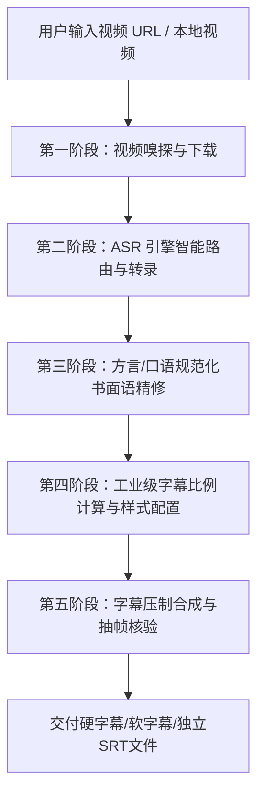

# 视频下载与智能字幕压制 (Video Download & Captioner)

本技能为通用 AI Agent 提供一站式视频处理与字幕工坊能力：涵盖网络视频流嗅探与下载、多方言智能 ASR 引擎路由、粤语/口语转现代规范简体中文精修、以及严格遵循影视工业级标准（自适应字高比例、防眩光厚描边、避让底栏 UI）的高清字幕合成压制。

---

## 核心能力与工作流概述



---

## 第一阶段：视频嗅探与下载

1. **环境与依赖自检**：
   - 依赖工具：`yt-dlp`、`ffmpeg`、`ffprobe`、`videocaptioner`（若未安装则执行 `pip install videocaptioner`）。
2. **下载策略选择**：
   - **通用平台**（YouTube / Bilibili / 抖音 / 微博等）：直接执行 `yt-dlp "<URL>" -o "video.mp4"`。
   - **专有流媒体门户**（如 Now 新闻、TVB 等专有播放器）：
     - 抓取页面源码定位核心播放器（如 `MediaPlayer.js`），提取流地址鉴权接口（详见 [流媒体下载策略](references/platform-download.md)）。
     - 获取真实 `.m3u8` 后通过 `yt-dlp "<m3u8_url>" -o "video.mp4"` 抓取分片并修复 MPEG-TS。
3. **视频规格探测**：
   - 执行 `ffprobe -v error -select_streams v:0 -show_entries stream=width,height,duration -of json "video.mp4"`，记录画面高度 $H$ 与时长，作为后续字号计算基准。

---

## 第二阶段：ASR 引擎智能路由与转写

调用 `videocaptioner transcribe` 执行语音识别，必须根据原视频语音语种精准分流引擎（详见 [ASR 引擎选型指南](references/asr-engine-guide.md)）：

- **粤语（广东话/香港口播）**：
  - **必选剪映引擎**：`videocaptioner transcribe video.mp4 -o sub.srt --asr jianying -v`
  - 严禁对粤语使用 `bijian`（必剪会将粤语按普通话同音字错录）。
- **标准普通话 / 国语解说**：
  - 选 `bijian` 或 `jianying`，识别速度快且免费无需 API Key。
- **外语 / 多语种混杂**：
  - 选 `whisper-api` 或本地 `faster-whisper`。

---

## 第三阶段：方言/口语规范化书面语精修

对于港台粤语或地方口语视频，ASR 转写出的内容通常包含大量方言字（如“𫪈”、“咧”、“噉”、“㖞”），直接使用会导致阅读体验极差。Agent 必须按以下标准对 SRT 进行精修：

1. **原样保留时间戳**：保持 SRT 序列编号与时间轴区间（`00:00:00,000 --> 00:00:02,500`）完全一致。
2. **方言口语转现代书面语**：
   - 详见 [粤语口语转化对照表](references/asr-engine-guide.md#3-粤语口语至规范中文简体转化规则表)。
   - 示例：“𫪈寻日𫪈立法会咧” $\rightarrow$ “昨天在立法会”；“医程通系咩嚟嘅咧” $\rightarrow$ “医承通到底是什么呢”。
3. **专有名词与机构实体核验**：
   - 对照视频官方标题、展板文字修正同音差错（如将“医程通/医生通过”纠正为“医承通”，将“一件通/疫情通”纠正为“医健通”）。

---

## 第四阶段：工业级字幕比例计算与样式配置

字幕过小是视频压制最常见的缺陷。Agent 在配置字幕样式时必须严格遵循影视工业级比例（详见 [字幕排版与视觉规范](references/subtitle-standards.md)）：

1. **字号计算法则**：
   $$\text{字号 (Font Size)} \approx H \times 5.8\% \quad (720\text{p} \approx 42\text{px}, \; 1080\text{p} \approx 60\text{px})$$
2. **样式要素约束**：
   - **字体**：无衬线加粗体（`Microsoft YaHei` 或 `Noto Sans SC`，`bold: true`）。
   - **文字颜色**：纯白 `#FFFFFF`。
   - **描边**：纯黑 `#000000`，宽度取字号的 $5\% \sim 6\%$（720p 约为 2.2px，1080p 约为 3.2px），防止画面亮色背景眩光。
   - **底边距（Margin Bottom）**：取高度的 $4.8\% \sim 6.0\%$（720p 设为 35px ～ 45px），确保文字悬浮于电视台底栏或播放器控制条上方。
3. **环境预设注入**：
   - 若 VideoCaptioner 报预设不存在，运行 `python scripts/init_styles.py` 自动注入 720p 与 1080p 标准 ASS 样式。

---

## 第五阶段：字幕压制合成与抽帧核验

1. **执行字幕压制**：
   - **硬字幕（直接内嵌画质最佳）**：
     ```bash
     videocaptioner synthesize video.mp4 -s sub_zh.srt --subtitle-mode hard --quality high --style-override '{"font_size": 42, "outline_width": 2.2, "margin_bottom": 35}' -o video_sub.mp4 -v
     ```
     *或直接使用辅助脚本*：`python scripts/burn_subtitles.py video.mp4 sub_zh.srt`
   - **软字幕（原画无损保留独立轨道）**：
     ```bash
     videocaptioner synthesize video.mp4 -s sub_zh.srt --subtitle-mode soft -o video_soft.mp4 -v
     ```
2. **视觉抽帧自检（关键闭环）**：
   - 提取中间关键帧图片：`ffmpeg -ss 00:00:20 -i video_sub.mp4 -vframes 1 -q:v 2 "check_frame.jpg" -y`
   - 通过图片阅读工具核验：字幕清晰度、是否有文字重叠、是否遮挡关键画面。确认无误后清理临时图片。

---

## 交付物与输出规范

向用户交付时，提供结构化的三位一体交付物：
1. **硬字幕视频成品**（任何设备开箱即播）；
2. **标准独立 SRT 字幕文件**（便于后期挂载二次编辑）；
3. **格式与尺寸说明卡**（标注分辨率、字号及适配说明）。
