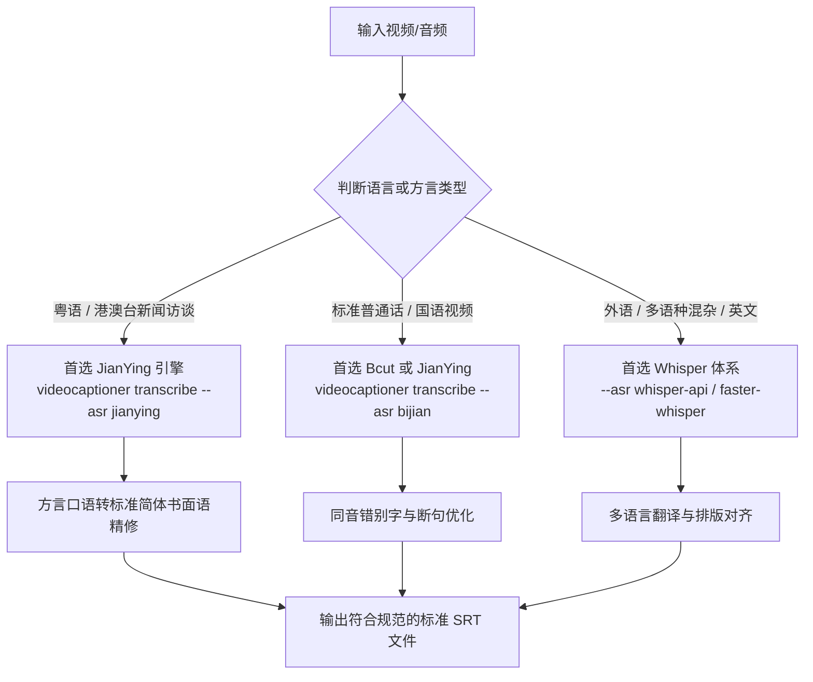

# ASR 语音识别引擎选型与多方言/语种适配指南

在执行多源视频的语音转字幕时，不同的 ASR 引擎在免费度、识别语种、方言兼容度及断句表现上差异显著。本指南提供系统化的引擎分流与避坑策略。

---

## 1. 核心 ASR 引擎对比矩阵

| ASR 引擎名称 | 对应参数 (`--asr`) | 费用 / Key 要求 | 最强优势场景 | 致命短板 / 注意事项 |
| :--- | :--- | :--- | :--- | :--- |
| **剪映 (JianYing)** | `jianying` | 免费 / 无需配置 | **粤语（广东话/香港口语）**、普通话口播、中文流行语 | 仅限中英双语；极长视频需自动切片上传 |
| **必剪 (Bcut)** | `bijian` | 免费 / 无需配置 | **标准普通话**、B站二次元/知识区解说 | 粤语支持弱（易将粤语发音识别为普通话同音字，如将“喺寻日”识别为“下次我还来”） |
| **Faster-Whisper** | 本地模型 | 免费 / 需本地GPU/CPU | **多语言混合（中日英德法韩等）**、私密离线环境 | 需安装 PyTorch/CUDA 环境，初次需下载模型权重 |
| **Whisper API** | `whisper-api` | 需 OpenAI API Key | 高杂音环境、多语种互译、长篇访谈会议 | 需消耗 API 额度，网络环境要求较高 |

---

## 2. 方言与多语种自动分流路由

---

## 3. 粤语口语至规范中文简体转化规则表

港澳新闻、采访与日常视频中包含大量粤语本字与助词，直译成字幕易造成非粤语区用户阅读障碍，必须规范化转写为现代汉语文内书面语：

| 粤语口语原词 | 规范书面语替换 | 语境说明与示例 |
| :--- | :--- | :--- |
| **𫪈 (喺)** | 在 / 于 | 𫪈立法会 → 在立法会 |
| **咗** | 了 / 已经 | 开咗会 → 开了会 |
| **噉** | 那么 / 这样 / 如此 | 噉就讨论 → 那么就讨论 |
| **嘅** | 的 | 提升嘅 → 提升的 |
| **㖞 / 咧 / 喇 / 啫** | （语助词，去留视语境） | 适当去除无意义语气助词，精炼字幕 |
| **咩嚟嘅** | 是什么呢 | 医程通系咩嚟嘅 → “医承通”到底是什么呢 |
| **点样** | 如何 / 怎样 | 点样用科技 → 怎样用科技 |
| **佢哋** | 他们 / 它们 | 支援佢哋日常 → 支援他们日常 |
| **一啲** | 一些 / 部分 | 储存市民嘅一啲资料 → 储存市民的一些资料 |
| **净系** | 仅仅 / 只是 / 专门 | 净系畀中医用 → 专门给中医使用 |
| **畀** | 给 / 供 | 畀中医用 → 供中医使用 |
| **倾下** | 聊聊 / 探讨 | 同我哋倾下 → 和我们一起探讨 |
| **早晨** | 早上好 | 早晨余医师 → 早上好，余医师 |
| **屋企人** | 家人 / 家属 | 屋企人都会用 → 家人也会用 |
| **后生** | 年轻 | 后生嘅医师 → 年轻的医师 |
| **㩒** | 按 / 点击 | 㩒一粒掣 → 按一个按键 |
| **过嗮去** | 全部转移过去 | 过嗮去新系统 → 全部转移到新系统 |
| **市面** | 市场上 / 行业内 | 市面上嘅系统 → 市场上的系统 |

---

## 4. 专有名词与机构实体核验机制

在转录新闻与专业访谈时，ASR 常常因同音字识别出错，Agent 在精修字幕时必须主动对照上下文核验专有实体：
- **同音字纠错**：例如将「医承通」误写为“医程通/医生通过”，将「医健通」误写为“一件通/疫情通”；
- **机构与人名核对**：根据标题、背景板及身份介绍核验姓名（如香港中医学会监事长 余韵乐）；
- **官方术语一致性**：与视频官方背景展板上的繁体字严格对应并转为规范简体。
